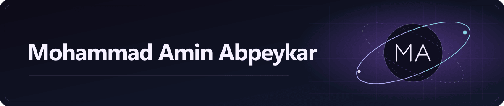

<h1></h1>

**Senior Full-Stack & Mobile Developer**

I build web and mobile products from architecture to release. My work spans React and React Native interfaces, Laravel and Node.js APIs, and the data and deployment workflows behind them.

## Product work

| Product | What I built |
| --- | --- |
| **[Dr. Sinuhe](https://drsinu.com/)** | APIs and administrative tools for healthcare reservations, payments, and financing workflows. |
| **[Dambal](https://dambalapp.com/)** | A fitness app for coaches and their clients. I worked on the React Native app, backend APIs, training plans, and real-time notifications. |

## Selected public code

| Repository | What to look at |
| --- | --- |
| **[SnapFood](https://github.com/AmAbpeykar/SnapFood)** | Laravel restaurant ordering with separate routes for customers, sellers, and administrators. |
| **[Laravel + Vue](https://github.com/AmAbpeykar/laravel_vue)** | Locale-aware Laravel routes and Vue components built with Vite. |
| **[Meteorology](https://github.com/AmAbpeykar/meteorology)** | A Laravel weather lookup by city or geographic coordinates. |

**Main stack** · TypeScript, React, Next.js, React Native, PHP, Laravel, Node.js, SQL Server, Redis, Docker

<h2>معرفی فارسی</h2>

محمد امین آب‌پیکر هستم، توسعه‌دهندهٔ ارشد فول‌استک و موبایل. در دکتر سینوهه روی فرایندهای رزرو، پرداخت و پنل مدیریت کار کرده‌ام. در Dambal اپلیکیشن موبایل و رابط‌های برنامه‌نویسی موردنیاز مربیان و کاربران را توسعه داده‌ام.

[Connect on LinkedIn](https://www.linkedin.com/in/aimeup/)
