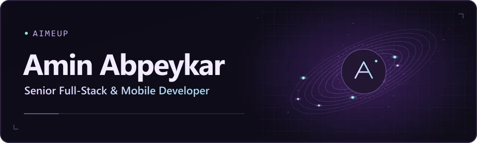

  

# Amin Abpeykar

I build and ship web and mobile products, from application architecture and backend APIs through release and production support. I have six years of software development experience, including three years in a senior full-stack role.

## Product work

- **[Dambal](https://dambalapp.com/)** — A fitness platform connecting coaches and trainees. I worked on the React Native app, backend APIs, training plan workflows, and real-time notifications.
- **[DrSinu](https://drsinu.com/)** — A healthcare platform for service reservations and payments. I built APIs and administration tools for booking, payments, and financial workflows.

## Engineering focus

- **Web and mobile** · TypeScript, React, Next.js, React Native, Expo
- **Backend and data** · Laravel, PHP, Node.js, REST APIs, SQL Server, Redis
- **Production** · Background jobs, real-time events, Docker, CI/CD, and performance tuning

<h2>معرفی فارسی</h2>

امین آب پیکر هستم، توسعه‌دهندهٔ ارشد فول‌استک و موبایل. شش سال در توسعهٔ نرم‌افزار تجربه دارم و سه سال از این مسیر را در نقش توسعه‌دهندهٔ ارشد فول‌استک کار کرده‌ام. در دمبال روی اپلیکیشن موبایل، فرایندهای برنامهٔ تمرینی و اعلان‌های لحظه‌ای کار کرده‌ام. در دکتر سینو هم رابط‌های برنامه‌نویسی و ابزارهای مدیریت رزرو و پرداخت را توسعه داده‌ام.

[Connect on LinkedIn](https://www.linkedin.com/in/aimeup/)

[Portfolio · aimeup.ir](https://aimeup.ir)
