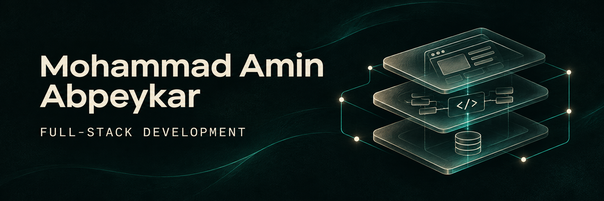

# Mohammad Amin Abpeykar

I build web products with Laravel, Node.js, React, and Next.js. My work connects the screens people use with the APIs, data, and release pipelines that keep them running.

## Currently building

**[Dr. Sinuhe](https://drsinu.com/)** is a healthcare financing platform. I work on the public web experience for finding care and applying for financing, as well as the reporting and integrations that support those workflows.

## Selected public projects

- **[SnapFood](https://github.com/AmAbpeykar/SnapFood)** — A Laravel restaurant-ordering project with distinct workflows for customers, sellers, and administrators.
- **[Laravel + Vue](https://github.com/AmAbpeykar/laravel_vue)** — A full-stack web project with locale-aware routing, Vue components, and Vite.
- **[Meteorology](https://github.com/AmAbpeykar/meteorology)** — A Laravel weather lookup app that accepts a city name or geographic coordinates.

## How I work

- **Product engineering** — Build the customer-facing flow and the tools the operations team needs to follow it through.
- **APIs and data** — Keep business rules explicit so reports and integrations agree on what happened.
- **Delivery** — Use Docker and GitHub Actions to build, release, and verify changes in production.

<h2>معرفی فارسی</h2>

من محمدامین آبپیکر، توسعه‌دهندهٔ فول‌استک هستم. روی توسعهٔ سایت دکتر سینوهه، مسیر درخواست تأمین مالی درمان و ابزارهای گزارش‌گیری و پیگیری این فرایند کار می‌کنم.

